# AdvNet: Revealing Performance Issues in Network Protocols by Generating Adversarial Environments

[SHEHAB SARAR AHMED](https://orcid.org/0000-0002-6063-2689), University of Illinois Urbana-Champaign, USA and BUET, Bangladesh [WILLIAM SENTOSA](https://orcid.org/0009-0001-5651-4786), University of Illinois Urbana-Champaign, USA [YINJIE ZHANG](https://orcid.org/0009-0006-0959-5452), University of Illinois Urbana-Champaign, USA [YOAV LEBENDIKER](https://orcid.org/0009-0009-7133-9435), The Hebrew University of Jerusalem, Israel [MICKEY SHNAIDERMAN](https://orcid.org/0009-0007-9973-3261), The Open University of Israel, Israel [TOMER GILAD](https://orcid.org/0009-0003-5319-4240), The Hebrew University of Jerusalem, Israel [NATHAN H. JAY](https://orcid.org/0009-0003-3139-6220), University of Illinois Urbana-Champaign, USA [BRIGHTEN GODFREY](https://orcid.org/0009-0003-2930-1982), University of Illinois Urbana-Champaign, USA [MICHAEL SCHAPIRA](https://orcid.org/0000-0002-9336-8351), The Hebrew University of Jerusalem, Israel

Infrastructure protocols like Congestion Control (CC) seek to provide reliable performance across a wide range of Internet environments. Currently, protocol designers assess performance through hand-designed test cases or data sets captured from real environments. However, such approaches may inadvertently overlook critical facets of the algorithm’s behavior when they encounter an unanticipated environment or workload.

We seek to understand the unanticipated with AdvNet, a system that automatically generates adversarial network environments that cause a target protocol implementation to perform poorly. AdvNet employs machine learning-based optimization to generate environments, and incorporates a robust noise-handling mechanism to mitigate the variability inherent in real-world protocol performance. Although our approach is more general, this paper focuses specifically on transport protocols and their CC implementations. We showcase AdvNet’s capability to create adversarial scenarios for 27 kernel-space implementations of both single-path and multi-path CC protocols, for several use cases with different performance goals. AdvNet identifies problematic network conditions that expose previously unnoticed Linux kernel bugs and uncovers hidden limitations in CC implementations, and provides insights about robustness. These results suggest that automated adversarial testing can be a valuable tool in protocol development, and that robustness is a useful new dimension for benchmarking CC protocols.

CCS Concepts: • **Networks** → **Transport protocols**; • **Computing methodologies** → Machine learning approaches.

Additional Key Words and Phrases: Congestion Control; Adversarial Environment Generation; Machine Learning for Systems

Authors’ Contact Information: [Shehab Sarar Ahmed,](https://orcid.org/0000-0002-6063-2689) University of Illinois Urbana-Champaign, Urbana, Illinois, USA and BUET, Dhaka, Bangladesh; [William Sentosa,](https://orcid.org/0009-0001-5651-4786) University of Illinois Urbana-Champaign, Urbana, Illinois, USA; [Yinjie Zhang,](https://orcid.org/0009-0006-0959-5452) University of Illinois Urbana-Champaign, Urbana, Illinois, USA; [Yoav Lebendiker,](https://orcid.org/0009-0009-7133-9435) The Hebrew University of Jerusalem, Jerusalem, Israel; [Mickey Shnaiderman,](https://orcid.org/0009-0007-9973-3261) The Open University of Israel, Raanana, Israel; [Tomer Gilad,](https://orcid.org/0009-0003-5319-4240) The Hebrew University of Jerusalem, Jerusalem, Israel; [Nathan H. Jay,](https://orcid.org/0009-0003-3139-6220) University of Illinois Urbana-Champaign, Urbana, Illinois, USA; [Brighten Godfrey,](https://orcid.org/0009-0003-2930-1982) University of Illinois Urbana-Champaign, Urbana, Illinois, USA; [Michael Schapira,](https://orcid.org/0000-0002-9336-8351) The Hebrew University of Jerusalem, Jerusalem, Israel.

Permission to make digital or hard copies of all or part of this work for personal or classroom use is granted without fee provided that copies are not made or distributed for profit or commercial advantage and that copies bear this notice and the full citation on the first page. Copyrights for components of this work owned by others than the author(s) must be honored. Abstracting with credit is permitted. To copy otherwise, or republish, to post on servers or to redistribute to lists, requires prior specific permission and/or a fee. Request permissions from permissions@acm.org.

© 2026 Copyright held by the owner/author(s). Publication rights licensed to ACM.

ACM 2834-5509/2026/6-ART12

[https://doi.org/10.1145/3808660](https://doi.org/10.1145/3808660)

## ACM Reference Format:

Shehab Sarar Ahmed, William Sentosa, Yinjie Zhang, Yoav Lebendiker, Mickey Shnaiderman, Tomer Gilad, Nathan H. Jay, Brighten Godfrey, and Michael Schapira. 2026. AdvNet: Revealing Performance Issues in Network Protocols by Generating Adversarial Environments. Proc. ACM Netw. 4, CoNEXT2, Article 12 (June 2026), 22 pages. [https://doi.org/10.1145/3808660](https://doi.org/10.1145/3808660)

## 1 Introduction

Applications, algorithms, and protocols that depend on the underlying network performance face a challenge in testing: networks are very diverse and encounter many possible conditions. This is particularly a problem for network protocols and systems like transport protocols that form infrastructure that an enormous number of applications and users depend on, across every corner of the Internet. We expect these protocols to perform dependably, across a vast range of conditions, encompassing varying network topologies, bandwidths, latencies, loss rates, and traffic loads, and patterns of change across time in all of the above.

As a specific example, imagine a scenario where a protocol designer is tasked with developing an upgraded version of an existing protocol. The innate intricacies associated with this new version, coupled with the extensive spectrum of environments in which the protocol is intended to function, pose a considerable testing challenge. The changes might be intended to help performance, but are there network environments where the changes might result in a poor tradeoff?

The most common way of testing a network protocol is running it in a test environment with manually-constructed parameters, e.g., a certain range of fixed bandwidth or latency [35]. An expanded set of tests might involve a dataset or trace of performance from a real environment which can be replayed in emulation [20, 25, 30, 31], or even running the protocol in a limited set of deployment tests [34]. However, these methods only cover a minuscule fraction of the diverse environments in which the algorithm might operate.

We propose that an effective way to address these challenges is to automatically discover instances where the protocol under test exhibits unexpected behavior. To that end, we intro duce a simple, yet effective, framework for automatically generating adversarial environments for network protocols, with a focus here on congestion control. This framework, AdvNet, trains a machine learning-based optimization algorithm whose goal is to create environments that damage performance of the target protocol (hereafter referred to as target). An environment here is a time-series or trace of network performance parameters across time, including bandwidth and latency, along with constant parameters like buffer size or total bytes to transmit.

Intuitively, an adversarial environment is one where target performs poorly, despite having the potential to improve its performance. To quantify this, AdvNet allows the user to specify a reference measure of performance (hereafter referred to as reference) that can be either a concrete protocol execution, or a calculation. AdvNet’s adversary then attempts to generate environments that maximize the performance gap between reference and target, which we call the score. AdvNet’s high-level architecture is shown in Figure 1.

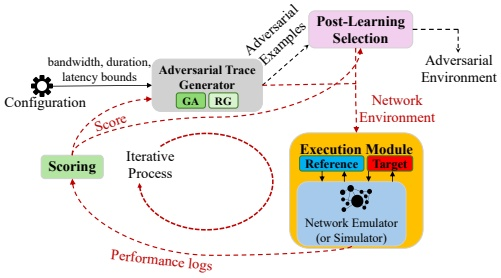

flowchart

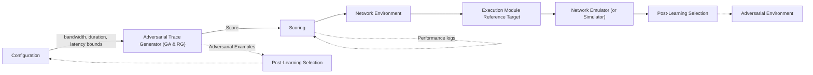

Fig. 1. High-level architecture of AdvNet.

Realizing the above approach brings both algorithmic and systems challenges. **(1) Sample efficiency:** A key goal of our work is to test real-world production code such as the Linux kernel and user-space implementations of TCP (rather than just simulations of their algorithms). The bottleneck is therefore running emulations of the target protocol in various network traces, meaning the adversary’s algorithm must be sample-efficient. Complicating matters further, emulation introduces non-deterministic noise that can confuse learning, especially since combating noise by repeatedly re-running emulations is expensive. **(2) Practical utility:** A second key goal is to explore whether adversarial testing can be practically useful for congestion control protocol implementations, which requires building a flexible implementation and applying it to use cases.

Adversarial environment generation for CC was previously proposed in a workshop paper that we extend [9] and in a more recent workshop paper, CC-Fuzz [22]. But [9, 22] did not solve the above challenges. CC-Fuzz runs in simulation, and when moving to emulation, we found that some of its design decisions result in relatively sample-inefficient learning in the sense that it achieves a relatively low score in a given budget of trace emulations (see §6 for a more complete comparison between our work and [9, 22]). Our work addresses these challenges, as follows.

**Sample-efficient learning algorithms.** We made several design choices to enable effective adversarial testing with a limited number of emulation runs. First, AdvNet uses a relatively compact environment representation that is less dependent on specific packet timings (unlike CC-Fuzz’s [22] use of packet delivery opportunity traces). Second, we evaluate several learning-based optimizers, including genetic algorithms (GA), Bayesian optimization (BO), and bandit learning (BL). Finally, we found that simple selection of the most adversarial trace is suboptimal due to emulation variance, and instead design a post-learning selection (PLS) algorithm which makes a better choice.

**Use cases and associated performance goals.** AdvNet allows a customizable definition of the reference, but how to use this differs depending on the use case. We specialize AdvNet by defining different realizations of reference and target for three use cases where adversarial testing is valuable: (UC1) finding suboptimal performance of individual protocols; (UC2) regression testing, i.e., finding cases where a new protocol version degrades performance relative to a prior version; and (UC3) validating specific performance objectives of the protocol designer.

**Implementation.** We implemented AdvNet including the learning module, integration with the Mahimahi [20] emulator, and orchestration to run tests. We extended Mahimahi to support multipath TCP, time-varying latency, and more efficient bandwidth trace input. AdvNet logs packetlevel events and the associated actions the emulator took on those packets; we found these logs useful to root-cause issues that AdvNet exposed. We also extended the emulator to support parallel execution, enabling more trials without affecting wall-clock time.

**Evaluation.** We begin by testing AdvNet’s design choices. First, we show that AdvNet’s representation of the network environment (with time-varying bandwidths and latencies) allows it to learn higher scores, outperforming CC-Fuzz’s representation by about 43% given the same ≈ 1 hour compute time (§4.2.1). Second, we show that our PLS algorithm improves performance by 26% over the baseline (§4.2.2). Third, we compared candidate optimization approaches, showing (among other results) that a Genetic Algorithm (GA) outperforms Random Generation (RG) by 23% on average (§4.2.3).

Having established our method, we applied AdvNet to the three use cases mentioned above, running an extensive set of tests across 27 transport protocol implementations. The goal of these tests was to determine whether AdvNet is able to successfully discover adversarial environments and whether those examples are useful. Key results include the following:

• AdvNet is able to find adversarial environments in most cases we tested – including 448 of 544 scenarios of two “all pairs” tests, with 17 Linux kernel TCPs as the target vs. every other as the reference. The magnitude of the adversary’s score varies greatly across scenarios, which provides insight into relative protocol robustness and points toward especially serious potential problems.

• (UC1): We root-caused several of the adversarial environments that AdvNet generated, identifying a rare corner-case bug in the Linux kernel that causes TCP to stop sending packets and enter the retransmission timeout (RTO) phase. We also found a second Linux kernel issue (confirmed by a BBR maintainer) where a TCP flow can abruptly decrease its sending rate and not recover.
• (UC2): We performed regression testing of bbr v3 vs. v1 with respect to the goal of fairness to cubic. AdvNet found it is possible for v3 to be more aggressive than v1. We also compared the two versions with respect to throughput. AdvNet identified scenarios in which bbr v1 achieves more than five times the throughput of bbr v3.
• (UC3): We tested the design goal that multipath TCPs should never worsen performance by using a second path. AdvNet found that all four CC implementations in the Linux kernel MPTCP, as well as DChannel [25], can violate that property. We investigated two of those scenarios in more detail (MPTCP’s balia algorithm and DChannel).

In summary, this paper makes three key contributions:

• We design and implement an automated framework that generates adversarial environments as a means of identifying performance issues in transport protocols.
• We conduct extensive experiments with AdvNet, and perform root-cause analysis of many of the resulting adversarial environments, demonstrating that adversarial environment generation is a useful way of discovering problems in real protocol implementations.
• AdvNet is available open source1, with a customizable interface for users to easily test their chosen protocols. Because AdvNet supports testing protocol implementations (rather than just simulations), it can be easily incorporated into research and development workflows.

We believe that measuring protocol robustness with AdvNet will be a valuable complement to traditional metrics like throughput and latency on known traces. While this paper and the current AdvNet implementation focus on congestion control, AdvNet can in principle be applied to any protocol with a quantifiable environment and performance metrics, and exploring other domains is a promising area of future work (§5).

## 2 Why Test Adversarially?

In both research and production, most testing of transport protocol implementations and their congestion control algorithms (CCAs) use a defined set of network conditions, either manually selected or logged from real-world observations. If these environments indeed mimic expected real-world conditions, isn’t that sufficient?

We argue that finding adversarial environments for protocols, independent of whether similar environments currently appear in deployment, is useful and complementary to traditional testing. An overarching reason is that transport protocols are critical infrastructure that need to work dependably in a diverse range of environments. More concretely, we discuss (and later evaluate) three use cases where we expect adversarial testing to be valuable.

## 2.1 Use Cases

**Finding environments with sub-optimal performance (UC1).** Transport protocols, and their CCAs, are notoriously difficult to design with consistently high performance across many environments, as evidenced by the long series of papers developing new designs. Even a minor change in the environment can significantly impact an algorithm’s performance; for example, the throughput of a TCP congestion control algorithm (CCA) can be severely reduced by even a slight increase in packet loss rate [19]. Adversarial testing can help augment traditional testing to discover unexpected environments that are problematic for a protocol, thus helping protocol designers and implementers improve them and create more robust protocols.

<small>1[https://github.com/Dariwala/AdvNet](https://github.com/Dariwala/AdvNet)</small>

But it is difficult for transport protocols to be optimal, especially measured relative to a theoretical limit. Suppose the performance goal is to maximize throughput; if network bandwidth suddenly increases, TCP cannot be expected to realize this and make use of the capacity immediately. Given that the protocol designer expects some imperfection, why is finding suboptimality useful? There are at least two reasons. First, although some suboptimality is to be expected, egregiously low performance can indicate bugs. Second, we can define the objective to be more realistic: rather than finding cases where a target protocol falls short of a theoretical limit, we can compare it to the performance of other protocol implementations, which are feasible by definition.

**Regression Testing (UC2)** checks whether modifications (such as redesigns, feature enhancements, or bug fixes) introduced new problems relative to the prior version, and is an integral part of production software releases. Transport protocols today are in a very active state of development, both in user-space transports like QUIC [17] and also in the kernel. For example, BBR v1 was integrated into the Linux kernel (version 4.9) in December 2016; Google introduced BBR v2 in 2019 to address some of v1’s limitations, and v3 in 2024.

Adversarial testing can find environments where version 𝑛 performs worse than version 𝑛 − 1. Beyond the general desire to achieve high performance as in UC1, adversarial examples are useful here for a couple reasons. First, developers are particularly attuned to understanding the effects of changes in production code, because any new change can introduce a new problem. Indeed, more broadly than just transport protocols, management changes are the leading cause of incidents in clouds [13]. Second, in some cases the goal of a change might be unrelated to performance, so the expectation is that there is no performance degradation, even in rare cases. Finding such cases is difficult and even tiny differences are important. To take an example outside the domain of transport protocols, Meta goes to great lengths to catch performance regressions in services, with a median performance effect of just 0.14% [6]! Worst-case testing is a good fit for such a goal.

**Validating design objectives (UC3).** Protocol designers often have specific objectives beyond generic performance goals. For instance, a primary goal of multi-path TCP (MPTCP) is to outperform single-path TCP [18]. A “do no harm” property is therefore relevant: an MPTCP should never perform worse with two paths than if the same protocol had been given just one of the two paths. Other examples might include safety properties like reducing rate when the network has high loss.

## 2.2 Design Goals

The three use cases above illustrate different situations where protocol developers can benefit from adversarial testing. These cases share some common requirements, which guide the design of AdvNet to provide a broadly useful framework:

**(a) Automatically tailored to each specific target protocol:** Different transport protocols have different tradeoffs and weaknesses. In all the above cases, we need to tailor the environment towards what is adversarial for a specific protocol, or even a specific protocol version, to find the most adversarial examples. Automating this is a good fit for learning-based algorithms.
**(b) Running real code:** Problems can arise not only in algorithms, but also in implementations, and understanding the actual code to be deployed gives the greatest assurance.
**(c) Optimization efficiency:** The search space of environments is multi-dimensional (e.g., latency and bandwidth) at even one moment, and problems often arise because of patterns of change across time. Combined with the fact that running real code is slow (relative to simulation), we need algorithms that optimize the adversary’s goal in limited time.

**(d) Flexible objectives:** The above use cases have a general commonality of comparing the performance of a target protocol to some reference (either an “oracle” definition of the optimal, or another protocol). However, the specific formulations differ, so the performance objective should be conveniently customizable.

## 3 Design

The AdvNet architecture is shown in Figure 1. Within the Configuration module, users define constraints (e.g., bounds on the network parameters), select target and reference to execute, and set hyperparameters. The Adversarial Trace Generator, or just the Adversary, generates candidate adversarial environments within those constraints. It sends each environment, the reference, and target to the Execution module The Execution module executes and computes the performance of reference and target within a network link created by a network emulator (or simulator) using parameters from the network environment. The Scoring module then computes the score of the network environment from the performance logs generated by the Execution module. The scores are given to the Adversary, which iteratively learns from them to attempt to generate more challenging network environments that maximize score. After a set amount of learning time, Post-Learning Selection (PLS) uses another limited execution time budget to choose the most adversarial trace found by the Adversary. Next, we discuss each of these components in more detail.

## 3.1 Network Environment

For concreteness we begin by defining the network environment, which is the type of object that AdvNet will generate.

Our network environment (or trace) is defined by an 𝑁-dimensional vector consisting of all parameters required to define the network and run target and reference within the network. The environment has a series of one or more time intervals. Each time interval has an associated bandwidth, latency, and duration. Additionally, there are time-invariant parameters: buffer length, and optionally, the amount of data to transmit2. Thus, we can define the network environment as: $T = \left( B , L , D , I \right)$ . Here, 𝐵 is the vector of bandwidths, 𝐿 is the vector of latencies, and 𝐷 is the vector of durations. Finally, 𝐼 is the set of all time-invariant parameters of the network environment. In multipath experiments, the network consists of two links, and therefore each of the time-variant parameters is specified per link, except for the duration (which defines a common time interval for both links). It is evident that the search space of 𝑇 is exponential.

The input to AdvNet includes bounds on allowed values for all the above parameters. Specifically, we provide a lower-bound vector $L B = \{ l _ { i } : 1 \leq i \leq N \}$ and an upper-bound vector $U B = \{ u _ { i } : 1 \leq$ $i \leq N \}$ to AdvNet. The optimization algorithm running within AdvNet ensures that each network environment $T = \left\{ t _ { i } : 1 \leq i \leq N \right\}$ , satisfies $l _ { i } \leq t _ { i } \leq u _ { i }$

## 3.2 Adversary

3.2.1 Adversary design choices. **Trace-based vs. action-based adversaries.** A trace-based adversary produces a complete trace, which is a time-ordered sequence of network conditions such as bandwidth and latency, as a single output. This type of adversary has the advantage of having access to the entire trace, enabling it to manipulate different aspects of the trace and observe the immediate effects of those changes. It can efficiently determine which parts of the trace to modify and in what direction to create more effective traces. However, this advantage may turn into a disadvantage when dealing with highly complex (high-dimensional) traces.

<small>2This could be time-variant too representing varying application demands. However, in this version of AdvNet we assume that either (a) the application is ready to send the full specified amount of data at the beginning of the trace, or (b) if the amount of data parameter is omitted, then we have the emulator send data continuously from start to end of the trace.</small>

On the other hand, an action-based adversary engages with a protocol by taking a series of actions, closely observing the protocol’s behavior at a fine-grained level, and providing only the next network conditions. For example, it might generate a single set of values representing bandwidth and latency for a specific duration. This type of adversary is adept at learning to create partial traces that lead to poor performance of target during that specific duration. However, integrating a protocol’s execution with an action-based adversary requires additional engineering complexity, as it necessitates monitoring and influencing the protocol’s live behavior and syncing the execution of reference and target, which would make it harder for users of AdvNet to easily extend the framework to test different protocols. We therefore opted to work with trace-based adversaries.

**Measuring success of the adversary.** At a high level, we want the adversary to find environments when the target algorithm performs poorly. But that statement is too simplistic: the adversary could simply design an environment which has zero throughput or 100% packet loss, which certainly results in poor performance but is uninteresting. Instead, we need to measure the adversary’s success relative to some sort of reference point.

We thus incorporate a reference measurement of performance (reference) into our framework. We instruct the adversary to generate environments that maximize the performance gap between reference and target. When a substantial performance gap emerges, it serves as an automatic indicator that the environment has successfully caused target to underperform. The Adversary generates network environments and sends them to the Execution module which creates network link(s) based on the environment’s parameters (e.g., time-varying bandwidths, latencies). We then direct the Execution module to assess target and reference within the network link(s). The relative difference in performance scores between reference and target, as provided by the Scoring module, serves as feedback to the optimization algorithm. This feedback loop helps the optimization algorithm learn to generate environments that result in a larger performance difference between reference and target.

**Stopping criterion.** In general, the learning phase of the adversary will improve with increased runtime. In our framework, we run the learning phase for a fixed duration or a predetermined number of iterations, which provides a consistent basis for comparing different adversarial strategies.

3.2.2 Optimization Algorithms. There are several candidate optimization algorithms suitable for training AdvNet’s adversary, including, but not limited to, evolutionary algorithms, Bayesian Optimization (BO), Bandit Learning (BL), and Reinforcement Learning (RL).

Although RL appears to be a natural choice, its effectiveness relies on selecting actions online while both reference and target are executing. In practice, this requires tight synchronization between the parallel runs of reference and target as well as the adversary. We found this synchronization requirement difficult to satisfy reliably. Small timing differences, scheduling latency, and inherent nondeterminism in executions often caused the two protocols to diverge in state, making it unclear which action was being applied to which underlying condition. As a result, RL agents frequently operated on stale or mismatched information, causing learning instability and ineffective policy updates. While these issues are likely solvable, the synchronization requirement introduces complexity and impacts overall flexibility of the design.

Therefore, we excluded RL and selected a diverse set of optimization strategies: GA from evolutionary methods, 𝜖-greedy search (EPS) as a lightweight variant of BL, BO as a model-based approach, and Random Generation (RG) as a baseline.

**Genetic Algorithm (GA).** The idea behind GA is to create a population of potential individuals to a problem, evaluate their fitness based on a defined objective function, and then apply operators like selection, crossover (recombination), and mutation to create new generations of individuals. These new generations are iteratively refined to improve the fitness of the solutions.

One limitation of the network emulator we use is that it only accepts integer values. Therefore, it is essential that mutation and crossover operations do not introduce floating-point numbers (rounding is an option, but would create confusion for the optimization algorithm), as this would alter the integrity of the traces. To ensure this, we employed 2-point crossover [27] and uniform mutation. Below is a brief description of these methods:

**(1) 2-point crossover:** Two random points are selected within the parent environments. The segments between these points are swapped between the parents to generate new offspring.
**(2) Uniform mutation:** For each element $t _ { i }$ in the trace, there is a predefined probability mut\_prob that $t _ { i }$ will be replaced by a randomly selected integer between its corresponding lower and upper bounds $l _ { i }$ and $u _ { i }$ (§3.1 describes the notations).

**Bayesian Optimization (BO).** BO is a sample-efficient global optimization technique that models the objective function using a probabilistic surrogate and selects new evaluation points by balancing exploration and exploitation. In our implementation, we use a tree-based surrogate model (random forest) to approximate the mapping from network environments to their corresponding score.

At each iteration, the surrogate model is updated with previously evaluated samples, and an acquisition function is used to determine the next candidate environment. Specifically, we employ the Lower Confidence Bound (LCB) acquisition function, which favors points with either high predicted score or high uncertainty. This enables systematic exploration of the search space while progressively focusing on promising regions.

𝜖**-Greedy Search (EPS).** We also consider EPS that balances exploration and exploitation without maintaining an explicit population or surrogate model. This approach can be viewed as a variant of multi-armed bandit learning, where candidate network environments correspond to arms and the observed score serves as the reward signal.

At each iteration, the algorithm selects between two actions: (i) sampling a new trace uniformly at random (exploration), or (ii) refining previously high-performing environments via mutation (exploitation). Specifically, with probability 𝜖, a candidate trace is generated by uniformly sampling each element $t _ { i }$ from its corresponding integer range $[ l _ { i } , u _ { i } ]$ . Otherwise, a trace is selected from an elite set containing the best-performing candidates observed so far, and a mutation operator is applied. The mutation independently perturbs each element $t _ { i }$ with a fixed probability by replacing it with a randomly sampled integer within its valid bounds.

To guide the search, we maintain a bounded elite set that stores a subset of the highest-scoring traces encountered during the optimization. This enables the algorithm to exploit promising regions of the search space while retaining diversity through random exploration.

**Random Generation (RG).** Under RG, environments are repeatedly generated by sampling parameter values uniformly from their allowed ranges. This process continues until the evaluation time limit expires. We use RG as a baseline.

## 3.3 Post-Learning Selection (PLS)

In the process of running the adversary for a set period of time, it generates a large number of environments (e.g., hundreds). The simplest final step would be to return the environment that showed the maximum score. That simple rule, which we call SimpleMax, was our initial implementation. However, we found SimpleMax produces a suboptimal result; and furthermore, when the environment picked by SimpleMax is independently re-tested, it on average produces a significantly lower score than the adversary observed during the training process.

The reason is that execution of an environment in emulation, and the protocols under test themselves, are nondeterministic and variable, with events potentially affected by small timing differences. When we execute an environment, we will sometimes observe a score that is higher than its true mean score, and sometimes lower. The true mean is not directly observable. By taking the environment whose observed scores were largest, there is a high chance that we are selecting the one which happened to have higher-than-average outliers in the observed scores.

To mitigate this issue, we introduced the PLS module. The idea is to spend some time performing a more careful evaluation of the environment that AdvNet should ultimately output. We dedicate a percentage of AdvNet’s overall execution time budget to PLS; this takes time away from the adversary’s learning phase, so PLS needs to make judicious choices in its evaluations. After the adversary (e.g., GA) runs, we retain the top 𝑁 environments based on their observed scores so far, and these form the input to PLS. PLS has a fixed time budget and has to decide how to distribute that among the 𝑁 candidate environments. After spending its budget, it then outputs the trace with highest observed mean score.

One might allocate the budget equally among the 𝑁 environments, which we call RoundRobin. But such uniform allocation is suboptimal. It turns out the problem is more subtle, and has arisen previously in the context of optimizing designs where simulation is expensive. In particular, the Optimal Computing Budget Allocation (OCBA) [5] seeks to maximize the probability of selecting the candidate with true largest mean. OCBA allocates evaluations adaptively by prioritizing envi ronments exhibiting higher uncertainty or those that are close in score to the current best. Thus, environments with smaller observed performance gaps from the best or larger empirical variances receive more evaluations, leading to statistically efficient identification of the best environment.

However, for our objective of maximizing the mean score of the returned environment, it is possible to do somewhat better. We designed a simple **Multi-Round Elimination (MRE)** algorithm. Each environment is evaluated once; the half of the candidates with lowest observed mean thus far is discarded. This continues, focusing evaluations on increasingly promising environments. When ≤ 5 environments remain, they are repeatedly evaluated without further elimination, until the evaluation budget is spent. We compared performance of RoundRobin, OCBA, MRE, and other algorithms in a simulator, abstracting the score emulation as sampling Gaussian random variables, and found MRE achieved highest performance (Appendix B), so we use it in our experiments with AdvNet. It is possible that this algorithm could be improved further in the future [8].

## 3.4 Execution Module

The adversary provides each network environment, along with reference and target, to the Execution module. The Execution module parses the network environment and extracts relevant information (e.g., parsing time-varying bandwidths to create uplink and downlink bandwidth files for the network emulator). Based on this information, the network emulator constructs network link(s) according to the specified parameters from the Execution module. The Execution module then runs reference and target on the network link(s), and creates their performance logs (e.g., per packet delays, timestamps when packets are sent and received etc.).

**Emulator.** We designed AdvNet with modular components, allowing each part to be modified independently without disrupting the overall workflow. As a result, AdvNet is compatible with both simulators and emulators, and we have used it with the ns3 simulator. However, we focus on emulation here, to test real protocol implementations.

We enhanced the Mahimahi network emulator [20] to meet our need of emulating time-varying latency and bandwidth. While Mahimahi (mm-link) natively supports time-varying bandwidth, it does not provide a mechanism for time-varying one-way delay. We extend the emulator to support this functionality by allowing it to ingest a latency trace that specifies a time series of delay values, along with separate bandwidth traces for the uplink and downlink. Finally, we extend the emulator from a single-path configuration to a dual-path setting by integrating mp-shell [7], enabling us to evaluate protocols such as MPTCP under repeatable and controlled multi-homing environments.

**Parallelization.** Training an adversary against real-world protocols presents a key challenge due to the high execution time of protocol runs. Obtaining statistically meaningful estimates of performance requires multiple repeated executions per environment, yet doing so significantly limits the number of environments that can be explored within a practical time budget. To address this scalability bottleneck, we extend Mahimahi to support parallel execution by spawning multiple independent emulator instances. We allocate a dedicated CPU core to each emulator instance, and additionally assign separate cores to the protocol client and server processes to ensure isolation. As a result, evaluating a single environment for one protocol requires three CPU cores operating concurrently. This design allows an environment to be evaluated multiple times simultaneously, effectively reducing wall-clock time and enabling broader exploration of the adversarial space.

## 3.5 Computing score

As previously mentioned, AdvNet aims to maximize the performance gap between reference and target. Consequently, score should quantify the performance difference of target relative to reference. Depending on how we define algorithm performance, a higher score can be either good or bad. For instance, higher throughput is desirable, while a higher completion time is undesirable. Formally, score of a network environment is defined as:

$$
\text {score} = \left\{ \begin{array}{l l} \frac {\text {reference\_score - target\_score}}{\max (\text {reference\_score, target\_score})} & \text {if higher score is better} \\ \frac {\text {target\_score - reference\_score}}{\max (\text {reference\_score, target\_score})} & \text {if lower score is better} \end{array} \right. \tag {1}
$$

The method for computing reference\_score and target\_score is customizable, depending on the use case. Our experiments used the following:

• (UC1) We conduct two types of experiments under this use case. First, we analyze the suboptimality of TCP protocols with respect to maximum throughput, by assigning the available bandwidth as reference\_score and the throughput of target as the target\_score. Second, we analyze how unfair a TCP protocol can be to another TCP. In this experiment, we set reference\_score to be the throughput of reference when run alone $( \tau _ { \mathrm { r e f \_ o n l y } } )$ , and set target\_score to be the throughput of reference when it is run with target simultaneously $( \tau _ { \mathrm { r e f } } )$
• (UC2) We also do two types of experiments in this use case. First, we compare the TCP protocol versions against each other with respect to a weighted sum of average packet delay and throughput. We compute both reference\_score and target\_score as: $t _ { \mathrm { c o e f f } } \times \tau _ { \mathrm { r e l } } + ( 1 - t _ { \mathrm { c o e f f } } ) \times d _ { \mathrm { r e l } }$ where $\begin{array} { r } { t _ { \mathrm { c o e f f } } \in [ 0 , 1 ] . \; \tau _ { \mathrm { r e l } } = \frac { \tau } { \tau _ { \mathrm { m a x } } } } \end{array}$ , and $\begin{array} { r } { d _ { \mathrm { r e l } } = \frac { d _ { \mathrm { m i n } } } { d } } \end{array}$ denote the relative throughput and relative delay, respectively. Here, 𝜏 and 𝑑 represent the achieved throughput and delay of the protocol. Second, we study how target can induce greater unfairness relative to reference when operating alongside a competing flow. To quantify this effect, we define reference\_score and target\_score as the throughput achieved by the competing flow when run concurrently with reference and target, respectively.

• (UC3) To validate MPTCP protocol performance, we calculate the throughput of MPTCP when it is limited to a single link, which we define as the reference\_score, and when it is provided with two links, which we define as the target\_score. Similarly, we evaluated DChannel [25] by defining reference to use only the high-bandwidth channel and target to use an additional low-latency channel. We use flow completion time (FCT) as the performance metric.

Although we illustrate each use case using CC protocols, we can apply Equation 1 to any domain where the goal is to maximize the performance gap between reference and target.

To reduce the impact of noise, while running the learning algorithm, we execute each protocol multiple times per environment and use the median reference\_score and median target\_score across runs. Furthermore, after AdvNet outputs the adversarial environment, we do an independent reevaluation of the environment to get rid of any possible bias in reported scores.

## 4 Experimental Results

## 4.1 Methodologies

4.1.1 Kernel-space Protocols. We used Linux kernel version 5.15.0-117-generic for all experiments involving TCP protocols and version 5.4.230.mptcp for all experiments involving MPTCP protocols. Additionally, we used Linux kernel version 6.13.7+ obtained from the official GitHub repository maintained by the Google BBR development team to compare bbr v1 with bbr v3.

4.1.2 Sending Traffic. We use iperf to send traffic over the network. The adversary determines the duration of the experiment, and we run iperf for that period. (The experiment with DChannel is slightly different, for historical reasons: the adversary specified the amount of data to transmit, and we run iperf until that amount is sent.)

4.1.3 Parameter Bounds. We use bounds for network parameters shown in Table 1, except for DChannel which is a completely different experiment and uses bounds in Table 3 (Appendix C). We enforce bandwidth at millisecond granularity.

|  | Bandwidth | Latency | Duration | Queue Length |
| --- | --- | --- | --- | --- |
| Lower Bound | 1 Mbps | 5 ms | 0.5 s | 500 |
| Upper Bound | 100 Mbps | 100 ms | 2.5 s | 10000 |

Table 1. Parameters used in all experiments with AdvNet involving TCP and MPTCP protocols. The lower and upper bounds for each parameter are defined per timestep.

## 4.2 Evaluation of AdvNet Design Choices

In this section, we evaluate the different components of the design of AdvNet.

4.2.1 Environment Definition and Comparison with CC-Fuzz Approach. CC-Fuzz [22] utilized fuzzing to create adversarial environments for TCP algorithms implemented in NS3. There are numerous differences with CC-Fuzz; for a full discussion, see §6. Here we explore one key design difference: the representation of network environment. AdvNet models the network environment as a dynamic system with varying bandwidth and latency over time, in a defined number of intervals, plus a constant buffer size. In contrast, CC-Fuzz represents the network environment through packet delivery opportunities (PDOs), where each PDO is a specific time instance when the network link can transmit a packet from the sender’s queue. Since the CC-Fuzz codebase is not available, we implemented this environment representation approach within AdvNet.

To evaluate these two approaches, we conducted experiments using GA as the optimization algorithm with both AdvNet and CC-Fuzz’s PDO approach, keeping all configurations (parameter bounds, runtime, etc.) identical except for the network environment definition. In this context, score represents the relative difference between the maximum achievable throughput and the through put of target. Thus, a higher score indicates a more adversarial environment. For CC-Fuzz’s approach, we

| TCP Protocol | AdvNet | CC-Fuzz |
| --- | --- | --- |
| bbr | 79.11% | 14.31% |
| cubic | 46.24% | 29.78% |
| vegas | 84.71% | 27.29% |
| reno | 41.26% | 28.8% |

Table 2. Best scores achieved by AdvNet and CC-Fuzz for UC1.

conducted experiments with four different values for the number of PDOs: 25, 50, 75, and 100. The best scores for **UC1** across various TCP protocols are presented in Table 2.

As is evident, AdvNet significantly outperforms CC-Fuzz’s PDO approach. There are two primary reasons for this. First, the search space dimensionality of PDO-based representation is inherently higher than that of AdvNet’s time-varying bandwidth and latency representation, leading to a more complex search problem. We demonstrated this by evaluating what happens when we increase the dimensionality, i.e., the number of PDOs. Higher dimensionality results in lower score for CC-Fuzz’s approach, e.g., 14.31% with 25 PDOs vs. 5.91% with 100 PDOs for bbr. This can be attributed to the fact that as the search space expands, GA struggles to find the optimal solution within the fixed execution time. Second, by using PDOs, CC-Fuzz does not directly incorporate latency in its definition of the network environment (although PDOs can capture certain latency effects). As we will discuss later, variations in link latency are critical for generating adversarial scenarios. Consequently, CC-Fuzz’s performance scores are significantly lower compared to those achieved by AdvNet.

Nevertheless, we emphasize that this comparison isolates only the differences in network environment representation between CC-Fuzz and AdvNet. The two systems differ along several other dimensions. For instance, CC-Fuzz employs an island-based genetic algorithm, whereas AdvNet uses a standard genetic algorithm. In addition, CC-Fuzz evaluates both link fuzzing (similar to AdvNet) and traffic fuzzing, which generates adversarial cross traffic.

4.2.2 Post-Learning Selection (PLS). Through our simulation study, we identified MRE as the most effective selection algorithm to apply once optimization algorithm completes (see Appendix B). After the optimization phase finishes, we take the top 25 discovered environments and pass them to MRE to determine the best environment.

To determine how the runtime should be divided between the optimization and PLS phases, we perform an experiment using cubic as reference, varying target over {bbr, highspeed, reno, vegas} and GA as the optimization algorithm. We utilize the pymoo library [4] (version 0.6.0) for GA. For each setting, we reserve a fraction of the total time budget for the PLS phase, with that fraction ranging from 0.1 to 0.5.

In Figure 2, we report the mean score obtained when varying the fraction of time allocated to PLS. Here, 0 indicates that PLS phase is not used and the optimization algorithm runs for the entire duration. We observe that allocating 10% of the runtime to PLS yields the best performance, and use this in our subsequent tests of AdvNet. Thus, the most effective strategy is to devote the majority of time to exploration via the optimization algorithm, and then apply MRE briefly to more accurately select the best trace, rather than omitting MRE entirely or applying it for an extended duration.

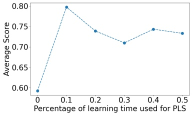

line

| Percentage of learning time used for PLS | Average Score |
| --- | --- |
| 0 | ~0.59 |
| 0.1 | 0.80 |
| 0.2 | ~0.74 |
| 0.3 | ~0.71 |
| 0.4 | ~0.74 |
| 0.5 | ~0.73 |

Fig. 2. Mean score achieved by GA+MRE under different time allocations for the PLS phase.

## 4.2.3 Optimization Algorithm. We first investigate the effect

of using the PLS phase with both GA and RG. Note that all of the optimization methods can continue improving their scores with additional evaluations. Therefore, to ensure a fair comparison, we impose a fixed runtime budget. Specifically, we allow each optimizer to run for one hour per experiment. When we enable the PLS phase, it consumes 10% of this budget (i.e., 6 minutes), after which we record the best achieved score.

In Figure 3a, we report the average scores obtained by GA and RG with and without the PLS phase across twenty scenarios, covering all pairwise combinations of reference and target drawn from the set {bbr, cubic, highspeed, reno, vegas} and using three values of $t _ { \mathrm { c o e f f } } \colon 0 ,   0 . 5 ,$ and 1. Across all three scenarios, GA consistently outperforms RG, and the PLS phase consistently improves performance over runs without PLS. These results show that actively training an adversary to generate adversarial environments is more effective than relying on random generation. They also demonstrate that selecting from previously discovered environments using PLS for some amount of time at the ending is more effective than exploring for new adversarial environments.

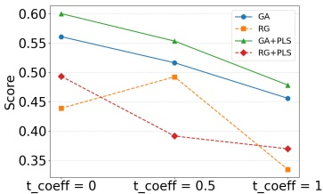

line

| Category | GA | RG | GA+PLS | RG+PLS |
| --- | --- | --- | --- | --- |
| t_coeff = 0 | ~0.56 | ~0.44 | ~0.60 | ~0.49 |
| t_coeff = 0.5 | ~0.52 | ~0.49 | ~0.55 | ~0.39 |
| t_coeff = 1 | ~0.46 | ~0.33 | ~0.48 | ~0.37 |

(a) Performance of GA and RG with and without PLS.

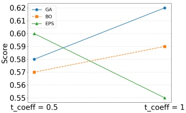

line

| Category | GA | BO | EPS |
| --- | --- | --- | --- |
| t_coeff = 0.5 | 0.58 | 0.57 | 0.60 |
| t_coeff = 1 | 0.62 | 0.59 | 0.55 |

(b) Performance of GA, BO & EPS.

Fig. 3. Performance comparison of optimization algorithms and the impact of the PLS phase.

We then compare the performance of GA, BO, and EPS. We implement BO using the skopt library (version 0.10.2). For EPS, we set the mutation probability (𝜖) to 0.3 and use an elite set of size 10. We evaluate them under the same combinations of reference and target as in the previous experiment, for two values of $t _ { \mathrm { c o e f f } }$ (0.5 and 1), over an extended runtime. Specifically, we run each experiment for two hours and allocate 10% of the budget (12 minutes) to the PLS phase at the end. Figure 3b shows the average performance of the three algorithms. We observe no clear winner across the evaluated settings, but GA has slightly higher average performance and we use it in our remaining tests of AdvNet.

4.2.4 Level of Parallelism. Next, we evaluate how the degree of parallelism affects performance. Recall (§3.4) that we use parallelism to run multiple emulation tests of the same trace. We observe that parallel evaluation provides only marginal gains compared to a single evaluation per environment due to emulator interference, though we suspect this can be improved in the future (Appendix A).

## 4.3 Comparison of TCP Protocols

So far we have evaluated the design choices within AdvNet. We now apply AdvNet to its intended purpose of testing protocols. Specifically, we evaluate the robustness of 17 TCP algorithms implemented in the Linux kernel. Using AdvNet, we conducted pairwise robustness comparisons of all 17 of the TCP protocols available in the Linux kernel. We gave AdvNet a time budget of 2 hour for each test, with the final 10% of the time reserved for the selection phase. Figure 4 shows the results: each cell represents the relative performance difference between the corresponding reference and target in the trace that AdvNet discovered.

This result offers several notable insights. First, each column contains at least one substantially positive value, indicating that every protocol exhibits some vulnerability under appropriately chosen adversarial environments. Second, the ability to expose a particular protocol’s weakness depends strongly on the choice of reference. Not all protocols, when used as reference, are capable of revealing the same vulnerability. For example, in the case of bbr with $t _ { \mathrm { c o e f f } } = 0 . 5 ,$ 6 out of the 16 protocols produce a large positive value, demonstrating that the effectiveness of adversarial discovery is reference-dependent.

In Figure 5, we plot each protocol’s mean score as target with $t _ { \mathrm { c o e f f } } = 0 . 5$ on the x-axis and $t _ { \mathrm { c o e f f } } = 1$ on the y-axis. The mean score as target measures **robustness**, i.e., lower values mean it is harder to attack the protocol with adversarial environments.

Interestingly, cdg achieves the lowest score along the x-axis, indicating that it offers the strongest robustness when balancing high throughput with low latency. In contrast, lp and htcp achieve low scores along the y-axis, making them preferable when prioritizing high throughput without regard to latency.

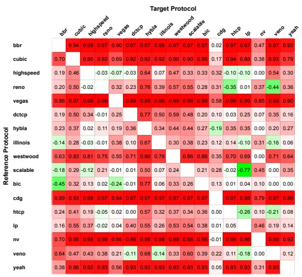

heatmap

| Reference Protocol | bbr | cubic | highspeed | reno | vegas | dtctp | hybla | illinois | westwood | scalable | bic | cdg | htcp | lp | nv | veno | yeah |
| --- | --- | --- | --- | --- | --- | --- | --- | --- | --- | --- | --- | --- | --- | --- | --- | --- | --- |
| bbr | — | 0.94 | 0.98 | 0.97 | 0.90 | 0.97 | 0.97 | 0.98 | 0.97 | 0.97 | 0.97 | 0.02 | 0.97 | 0.97 | 0.47 | 0.97 | 0.92 |
| cubic | 0.70 | — | 0.90 | 0.92 | 0.69 | 0.92 | 0.92 | 0.92 | 0.90 | 0.90 | 0.95 | 0.17 | 0.94 | 0.88 | 0.38 | 0.93 | 0.79 |
| highspeed | 0.19 | 0.46 | — | -0.03 | -0.07 | -0.03 | 0.64 | 0.07 | 0.47 | 0.33 | 0.33 | 0.32 | -0.10 | -0.10 | 0.00 | 0.54 | 0.30 |
| reno | 0.20 | 0.50 | -0.02 | — | 0.32 | 0.23 | 0.76 | 0.39 | 0.57 | 0.55 | 0.28 | 0.31 | -0.35 | 0.01 | 0.37 | -0.44 | 0.36 |
| vegas | 0.86 | 0.97 | 0.99 | 0.99 | — | 0.99 | 0.99 | 0.99 | 0.99 | 0.99 | 0.99 | 0.58 | 0.99 | 0.99 | 0.85 | 0.99 | 0.90 |
| dtctp | 0.19 | 0.50 | 0.34 | -0.01 | 0.25 | — | 0.77 | 0.50 | 0.59 | 0.48 | 0.20 | 0.10 | 0.03 | 0.25 | 0.07 | 0.35 | 0.16 |
| hybla | 0.23 | 0.37 | 0.02 | 0.11 | 0.19 | 0.36 | — | 0.34 | 0.44 | 0.44 | 0.27 | -0.19 | 0.35 | 0.35 | 0.00 | 0.20 | 0.27 |

(a) $t _ { \mathrm { c o e f f } } = 0 . 5$

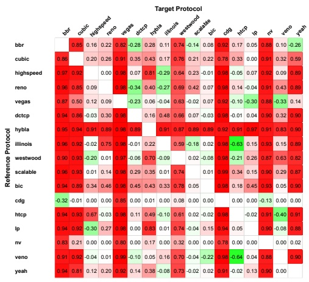

heatmap

| Reference Protocol | bbr | cubic | highspeed | reno | vegas | dtzcp | hybla | illinois | westwood | scalable | bic | cdg | htcp | lp | nv | veno | yeah |
| --- | --- | --- | --- | --- | --- | --- | --- | --- | --- | --- | --- | --- | --- | --- | --- | --- | --- |
| bbr | — | 0.85 | 0.16 | 0.22 | 0.82 | -0.28 | 0.28 | 0.11 | 0.74 | -0.14 | 0.08 | 0.92 | 0.17 | 0.05 | 0.88 | 0.10 | 0.26 |
| cubic | 0.86 | — | 0.20 | 0.26 | 0.91 | 0.35 | 0.43 | 0.17 | 0.76 | 0.21 | 0.22 | 0.78 | 0.33 | 0.00 | 0.91 | 0.32 | 0.59 |
| highspeed | 0.97 | 0.92 | — | 0.00 | 0.98 | 0.07 | 0.81 | -0.29 | 0.64 | 0.23 | -0.01 | 0.98 | -0.05 | 0.07 | 0.92 | 0.09 | 0.89 |
| reno | 0.96 | 0.85 | 0.09 | — | 0.98 | -0.34 | 0.40 | -0.27 | 0.69 | 0.42 | 0.07 | 0.98 | 0.14 | -0.04 | 0.91 | 0.43 | 0.89 |
| vegas | 0.87 | 0.50 | 0.12 | 0.09 | — | -0.23 | 0.06 | -0.04 | 0.63 | -0.02 | 0.07 | 0.92 | -0.10 | -0.30 | 0.88 | -0.33 | 0.14 |
| dtzcp | 0.94 | 0.85 | -0.03 | 0.30 | 0.98 | — | 0.16 | 0.48 | 0.66 | 0.07 | -0.03 | 0.98 | -0.01 | 0.04 | 0.90 | 0.32 | 0.90 |
| hybla | 0.95 | 0.94 | 0.91 | 0.89 | 0.98 | 0.89 | — | 0.91 | 0.87 | 0.89 | 0.89 | 0.92 | 0.91 | 0.97 | 0.91 | 0.83 | 0.90 |

(b) $t _ { \mathrm { c o e f f } } = 1$

Fig. 4. Pairwise robustness comparison of 17 TCP protocols.

The relative position of each protocol in this plot is highly sensitive to the choice of $t _ { \mathrm { c o e f f } } ,$ , which determines the priority given to throughput versus latency. For example, when we set $t _ { \mathrm { c o e f f } } = 1   ( \mathrm { i . e . }$ assigning zero weight to latency), a specific bug in bbr is triggered (§4.4.1), causing all scenarios with bbr as target to yield scores above 0.8. Similarly, vegas, which relies on delay as a congestion signal, also becomes an easy target under this setting, achieving scores above 0.9 regardless of the choice of reference.

## 4.4 Looking Inside the Box

In this section, we conduct a detailed analysis of the adversarial environments generated by AdvNet across different experiments. We aim to understand the underlying causes of adversarial behavior and, where possible, propose potential fixes to mitigate these issues.

4.4.1 Case 1: bbr. AdvNet successfully identified network environments where the Linux kernel implementation of bbr exhibited unexpected behavior. Upon examining the logs, we discovered an intriguing pattern in this anomalous behavior: AdvNet manipulated the network conditions by maintaining a high RTT for about

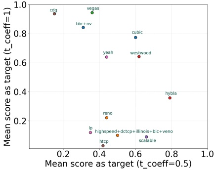

scatter

| Entity | Mean score as target (t_coeff=0.5) | Mean score as target (t_coeff=1) |
| --- | --- | --- |
| cdg | ~0.17 | ~0.94 |
| bbr+nv | ~0.32 | ~0.84 |
| vegas | ~0.36 | ~0.95 |
| yeah | ~0.43 | ~0.64 |
| cubic | ~0.61 | ~0.78 |
| westwood | ~0.63 | ~0.64 |
| hybla | ~0.79 | ~0.36 |
| llp | ~0.35 | ~0.13 |
| reno | ~0.44 | ~0.22 |
| htcp | ~0.43 | ~0.04 |
| highspeed+dctcp+illinois+bic+veno | ~0.51 | ~0.11 |
| scalable | ~0.65 | ~0.07 |

Fig. 5. Mean score of each protocol as target for $t _ { \mathrm { c o e f f } } = 0 . 5$ and $t _ { \mathrm { c o e f f } } = 1$

one second before abruptly reducing it. Some packets sent during the high RTT phase experienced long delays in reaching the destination, while later packets, benefiting from the lower RTT, arrived earlier. This out-of-order arrival triggered the receiver to generate duplicate acknowledgments (dup ACKs). Due to the low RTT, these dup ACKs quickly reached the sender. Upon receiving three dup ACKs, the sender initiated a fast retransmission for an earlier packet that was not lost but was simply taking longer to arrive. Interestingly, despite the fast-retransmitted packet experiencing a lower RTT, the original delayed packet still arrived first. When the receiver received this packet, it sent an ACK for the next packet in sequence. However, upon later receiving the fast-retransmitted packet, an issue arose in its logic for updating the acknowledgment number. As a result, even after the next expected packet was received, the acknowledgment number was not updated correctly. The receiver continued sending dup ACKs, ultimately forcing bbr into the retransmission timeout (RTO) phase.

To verify that TCP was indeed entering the RTO phase, we used eBPF to hook into the relevant TCP function. Additionally, we employed Wireshark to analyze whether the packet, for which the receiver continuously sent dup ACKs, was actually received by the kernel or dropped for some reason. Wireshark confirmed that the packet was indeed received by the kernel but was mishandled due to the specific sequence of events described earlier.

We observed that bbr behaves fundamentally differently from other TCP protocols. Unlike traditional congestion control algorithms, which send bursts of packets based on the congestion window and wait for their acknowledgments, bbr gradually sends packets while attempting to maintain a fixed number of packets in the network. This unique characteristic allowed AdvNet to manipulate network conditions in a way that induced the specific sequence of events with bbr, ultimately triggering the bug in the Linux kernel.

We further attempted to verify whether this behavior persists when using the latest Linux kernel version 6.13.7+ released by the BBR development team at Google. Under this version, AdvNet was unable to uncover scenarios exhibiting the previously observed bug. However, AdvNet did identify scenarios in which both bbr v1 and bbr v3 perform significantly worse than other TCP protocols such as cubic and vegas.

Figure 6 shows one such example. The throughput of bbr v3 remains low throughout the entire experiment, whereas cubic quickly ramps up and sustains a higher throughput. We extended the experiment duration to examine longer-term behavior and found that, over time, bbr v3 gradually increases its throughput and eventually approaches higher rates. Upon further investigation, we observed that the BBR develop ment team recommends using bbr with the fq qdisc, whereas Mahimahi defaults to fq\_codel. We modified our setup to use fq, but the same slow convergence behavior of bbr persisted.

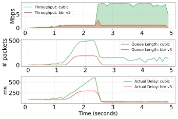

area_stacked

| Time (seconds) | Throughput: cubic (Mbps) | Throughput: bbr v3 (Mbps) | Queue Length: cubic (# packets) | Queue Length: bbr v3 (# packets) | Actual Delay: cubic (ms) | Actual Delay: bbr v3 (ms) |
| --- | --- | --- | --- | --- | --- | --- |
| 0 | ~10 | ~5 | ~0 | ~0 | ~180 | ~180 |
| 1 | ~10 | ~5 | ~20 | ~0 | ~180 | ~180 |
| 2 | ~10 | ~10 | ~450 | ~200 | ~350 | ~280 |
| 2.5 | ~10 | ~10 | ~150 | ~0 | ~180 | ~180 |
| 3 | ~10 | ~10 | ~150 | ~0 | ~180 | ~180 |
| 4 | ~10 | ~10 | ~100 | ~0 | ~180 | ~180 |
| 5 | ~10 | ~10 | ~150 | ~0 | ~180 | ~180 |

Fig. 6. Adversarial environment for bbr v3.

4.4.2 Case 2: bbr vs. cubic. This scenario moves to a different objective – fairness. We tasked AdvNet with identifying network environments in which the Linux kernel implementation of cubic is unfair to bbr. The goal of this experiment was to assess whether and to what extent cubic can be unfair to bbr, as the general perception in the networking community is that bbr tends to dominate other TCP flows [29]. However, AdvNet discovered network conditions where cubic consumed nearly 100% of the available bandwidth, leaving bbr starved. Interestingly, we observed a similar outcome when we reversed the roles of reference and target, instructing AdvNet to find scenarios where bbr is unfair to cubic.

Upon closer examination, we observed that target initially operates as expected for a certain period (ranging from 40 to 80 seconds, depending on the environment). However, beyond this point, it abruptly reduces its sending rate to a single packet at a time—waiting for an ACK before sending the next packet. This behavior persisted for the remainder of the experiment (lasting between 25 and 60 seconds). We reported this issue to the official bbr development team, who acknowledged the environment was problematic.

4.4.3 Case 3: DChannel. We now move to a multipath test: are two paths always better than one? DChannel [25] is designed to exploit a high bandwidth path (HBP) and a low latency path (LLP) in parallel. AdvNet was able to identify network environments where DChannel can perform three times worse in throughput compared to using only the high bandwidth path. DChannel steers packets along each path unbeknownst to the transport layer and application, which can cause the sender (i.e., CC) to misinterpret the observed network condition. It was reported previously in [28] that DChannel can confuse delay-based TCP, such as bbr, as the increased delay caused by switching packet delivery from the LLP to the HBP path is misinterpreted as a congestion signal. However, their tests did not identify issues with DChannel when using cubic, a loss-based CC.

AdvNet discovered that DChannel performs poorly in a condition where there is a substantial difference in path latency between the HBP (120 ms one-way latency) and LLP (3 ms one-way latency). We observed that cubic with DChannel experiences retransmission timeouts, leading to reduced throughput. This issue arises because DChannel’s heuristic favors sending small control packets (e.g. TCP handshakes) over the LLP while sending large data packets to the HBP. This will confuse early RTT measurement [24], as CC thinks that the path RTT is equal to the RTT of LLP, leading to a low RTO timer3. Therefore, when DChannel subsequently steers packets to the HBP which induces high latency, the RTO timer expires, triggering retransmission and causing CC to reduce its sending rate. We also confirmed that when we reduced HBP’s RTT (to < 200 ms, making it similar to what was used in [28]), DChannel outperforms the single path HB.

We compared the throughput over time of DChannel (with different values of its internal 𝛼 parameter) and a single HBP (labeled “only eMBB”) in Figure 7 when we downloaded a 20MB file size. DChannel calculates the reward (R) of sending a packet to the LLP and its associated cost (C), and sends that packet to LLP only if $R   >   \alpha \times C .$ Thus, 𝛼 directly impacts the number of packets steered to LLP. DChannel sets the default 𝑎𝑙𝑝ℎ𝑎 value to 0.75. The result shows that cubic without DChannel (all-hb) outperforms cubic with DChannel regardless of the different 𝛼 values, although increasing this value softens this issue. This implies that DChannel’s pathological behavior cannot be fixed by simply adjusting 𝛼.

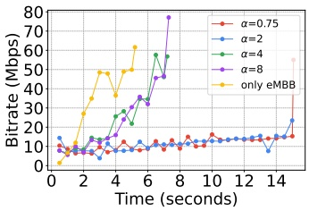

line

| Time (seconds) | \(\alpha=0.75 (\)Mbps) | \(\alpha=2 (\)Mbps) | \(\alpha=4 (\)Mbps) | \(\alpha=8 (\)Mbps) | only eMBB (Mbps) |
| --- | --- | --- | --- | --- | --- |
| 0.5 | ~9 | ~14 | ~9 | ~9 | ~2 |
| 1.5 | ~9 | ~9 | ~9 | ~9 | ~11 |
| 2.0 | ~9 | ~9 | ~9 | ~9 | ~23 |
| 2.5 | ~9 | ~13 | ~13 | ~13 | ~35 |
| 3.0 | ~9 | ~14 | ~14 | ~14 | ~49 |
| 3.5 | ~9 | ~4 | ~14 | ~14 | ~49 |
| 4.0 | ~9 | ~9 | ~26 | ~26 | ~37 |
| 4.5 | ~13 | ~9 | ~27 | ~27 | ~49 |
| 5.0 | ~9 | ~9 | ~22 | ~22 | ~50 |
| 5.5 | ~9 | ~13 | ~36 | ~36 | ~62 |
| 6.0 | ~13 | ~10 | ~35 | ~35 | — |
| 6.5 | ~9 | ~13 | ~57 | ~47 | — |
| 7.0 | ~13 | ~13 | ~57 | ~47 | — |
| 7.5 | ~9 | ~13 | — | ~77 | — |
| 8.0 | ~15 | ~13 | — | — | — |
| 8.5 | ~10 | ~13 | — | — | — |
| 9.0 | ~10 | ~13 | — | — | — |
| 9.5 | ~16 | ~13 | — | — | — |
| 10.0 | ~13 | ~13 | — | — | — |
| 10.5 | ~13 | ~14 | — | — | — |
| 11.0 | ~14 | ~14 | — | — | — |
| 11.5 | ~14 | ~14 | — | — | — |
| 12.0 | ~14 | ~14 | — | — | — |
| 12.5 | ~14 | ~14 | — | — | — |
| 13.0 | ~14 | ~7 | — | — | — |
| 13.5 | ~14 | ~14 | — | — | — |
| 14.0 | ~14 | ~14 | — | — | — |
| 14.5 | ~15 | ~23 | — | — | — |
| 15.0 | ~37 | — | — | — | — |

Fig. 7. Bitrates across time for DChannel with different values of 𝛼 and with only eMBB.

4.4.4 Case 4: MPTCP with 1 link vs. 2 links. We evaluated all four MPTCP congestion control protocols available in the Linux kernel—lia, olia, balia, and wvegas. In each case, AdvNet identified scenarios where performance degrades when the protocol is provided with two links compared to operating over a single link. We further investigated this behavior for balia, and observed that the throughput of balia with two links (balia2) was 85.5% lower than that of balia with a single link (balia1).

Figure 8 illustrates the number of bytes sent over time for the two scenarios. Initially, balia2 performs better by taking advantage of the high bandwidth of link 1. However, balia1 quickly catches up and surpasses balia2 after approximately 500 ms. At around 1200 ms, an interesting event occurs: balia2 reduces its sending rate on both link 1 and link 2, despite link 1 still having high bandwidth. We discovered that the receiver had delayed acknowledging the receipt

of a packet by roughly 40 ms. This delay led balia2 to significantly lower its sending rate across both links.

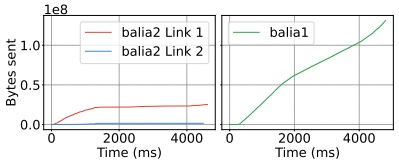

line

| Time (ms) | balia2 Link 1 (Bytes sent) | balia2 Link 2 (Bytes sent) | balia1 (Bytes sent) |
| --- | --- | --- | --- |
| 0 | 0 | 0 | 0 |
| ~1000 | ~0.2e8 | ~0.02e8 | ~0.3e8 |
| ~2000 | ~0.22e8 | ~0.02e8 | ~0.6e8 |
| ~4000 | ~0.25e8 | ~0.02e8 | ~1.0e8 |
| ~4500 | ~0.27e8 | ~0.02e8 | ~1.3e8 |

Fig. 8. Number of bytes transmitted over time by balia1 and balia2.

4.4.5 Case 5: bbr v1 vs. bbr v3. Here, we analyze the fairness behavior of bbr v1 and bbr v3 using the latest official kernel (version 6.13.7+) released by the BBR development team. For this experiment, we first allow AdvNet to manipulate bandwidth and latency parameters, and then continue execution for an additional one minute with fixed parameters to allow the protocols to stabilize. We then measure performance during the final ten seconds of the run. Interestingly, AdvNet identifies scenarios in which cubic achieves 12 times more throughput than bbr v1 when run concurrently. However, when bbr v1 is replaced with bbr $\nabla 3 ,$ the roles reverse: cubic obtains 11.6 times less throughput compared to bbr $\mathsf { v 3 ^ { 4 } }$

<small>3We confirmed that the minimum RTO timer in the linux kernel is roughly 200 ms</small>

## 5 Discussion and Future Work

We see several directions for extending AdvNet beyond the current setting.

First, while we demonstrate AdvNet in the context of congestion control, the core idea of adversarial environment generation applies more broadly to systems whose performance depends on complex and dynamic environments. Examples include adaptive bitrate (ABR) video streaming, microservice workloads, and cloud resource management. In fact, we have already built a prototype integration of AdvNet for ABR video. Extending AdvNet to new domains, however, introduces domain-specific challenges, particularly in defining the environment space and designing suitable adversarial generators. For instance, ABR systems require modeling video chunk sizes and player behavior, while microservices require capturing workload patterns and inter-service dependencies.

Second, AdvNet can be extended to support richer and more realistic network environments. Our current implementation, based on Mahimahi, models time-varying bandwidth and latency, with packet loss arising implicitly from buffer constraints. However, congestion control performance also depends on other factors such as workload characteristics (e.g., flow size distributions, concurrency, and burstiness), network topology, and deployment scale. Incorporating these factors would require extending both the environment representation, the underlying emulator or simulator and the optimization algorithm. For example, modeling network topology would require representing environments as graphs, which in turn would necessitate adapting the optimization algorithms to operate over structured inputs. Similarly, incorporating workload dynamics would require expanding AdvNet to generate not only link conditions but also traffic patterns.

Third, our current framework does not attempt to explain why a given adversarial environment degrades protocol performance. AdvNet focuses on generating challenging scenarios, leaving rootcause analysis to the user, as in many existing test-generation systems. An interesting direction for future work is to automatically characterize and summarize the regions of the environment space that induce adversarial behavior, which could provide actionable insights for protocol designers.

Overall, while AdvNet provides a first step toward adversarial environment generation for protocol design, extending it to broader settings will require rethinking both the environment representation and the adversary design to account for domain-specific complexities.

## 6 Related Work

**Testing Network Protocols.** Testing the performance of network protocols has long been an important part of networking. As a result, a vast collection of simulators [16, 23] and emulators [20, 30] provide a means to test many network protocols.

There are also other works aiming at creating more robust protocols. For instance, Pantheon [34] runs a variety of congestion control protocols on real-world paths and emulated paths intended to reflect a spectrum of real world scenarios. Puffer [33] streams video using different adaptive video streaming protocols on real-world network. Though they run on real-world paths, however, both Pantheon and Puffer may not be as appropriate for identifying and replicating the exact conditions that cause undesirable behavior, since such conditions might only arise when other uncontrolled real world processes take place. The most basic difference, however, is that [33, 34] and similar systems test real-world conditions, but do not seek out (potentially unknown) worst-case conditions. In general, our work should not be seen as a replacement for running realistic tests. Instead, realistic tests and adversarial tests are complementary. Our work should be regarded as a way to generate a broader set of test cases to improve robustness and understand a protocol’s flaws.

<small>4The anomalous behavior observed here is a direct consequence of the suboptimal behavior of the bbr versions discussed earlier</small>

**Adversarial Testing of Networking Protocols.** Our work builds on an earlier workshop paper [9] that employs RL to identify adversarial instances where ABR and CC protocols significantly deviate from optimality, using a model of optimality. The present paper develops a system for emulation rather than simulation and specializes this for three use cases. Perhaps most importantly, we performed an extensive set of tests of real protocols and root-caused problems, resulting in discovery and understanding of multiple Linux kernel and other issues.

More recently, another workshop paper [22] harnessed GA to generate adversarial network environments and traffic patterns for several CC algorithms, successfully uncovering bugs in the NS3 implementation of bbr and cubic. In contrast, our work is designed for emulation rather than only simulation, and deals with associated noise tolerance using PLS; defines network environments as time-varying bandwidths and latencies (as opposed to PDOs), which we showed results in better performance. GENET [32] introduced the idea of finding performance gaps between two protocols, for a different goal than ours, namely incorporating curriculum learning to improve the training effectiveness of RL-based network protocols.

[2] developed a Congestion Control Anxiety Controller to formally verify certain properties of congestion control (CC) algorithms, while [1] introduced a theoretical model for analyzing two competing flows and explored the potential starvation of delay-convergent CCs. The key distinction between AdvNet and these works is that AdvNet focuses on real implementations, whereas these studies aim to validate specific characteristics of CC algorithms in simplified network models. We believe these directions are both valuable and complementary.

**ML-based input generation.** ML-based input generation has been explored previously; we discuss this in more detail in §D.

**Formal methods–based adversarial testing.** Formal methods have also been used to generate adversarial inputs for complex systems. For example, LTEInspector [15] leverages symbolic analysis to generate adversarial scenarios for 4G LTE control-plane protocols. Symbolic execution engines such as [4] and [10] have been widely used to automatically explore program paths and generate inputs that trigger errors. Similarly, model checking tools like [14] have enabled systematic explo ration of protocol state spaces to detect correctness violations. However, these techniques typically require precise protocol models or specifications and often struggle to scale to large, continuous, or poorly structured input spaces such as network environments with time-varying dynamics.

## 7 Conclusion

In this paper, we seek to identify implementation flaws or suboptimal performance within transport protocols. We achieve this by employing a learning algorithm that acts as an adversary, generating adversarial network environments attempting to maximize the performance gap between target and reference. Our framework has successfully conducted robustness testing on all TCP and MPTCP protocols implemented in the kernel. AdvNet gave an understanding of overall protocol robustness, identified several issues and provided insight into the causes.

## 8 Acknowledgments

This project was supported by NSF awards 2008971 & 2326576, ISF grants 1508/17 & 3481/24 and BSF grants 2019798 & 2023663.

## References

[1] Venkat Arun, Mohammad Alizadeh, and Hari Balakrishnan. 2022. Starvation in end-to-end congestion control. In Proceedings of the ACM SIGCOMM 2022 Conference. 177–192.
[2] Venkat Arun, Mina Tahmasbi Arashloo, Ahmed Saeed, Mohammad Alizadeh, and Hari Balakrishnan. 2021. Toward formally verifying congestion control behavior. In Proceedings of the 2021 ACM SIGCOMM 2021 Conference. 1–16.
[3] Lionel C Briand. 2008. Novel applications of machine learning in software testing. In 2008 The Eighth International Conference on Quality Software. IEEE, 3–10.
[4] Cristian Cadar, Daniel Dunbar, Dawson R Engler, et al. 2008. Klee: unassisted and automatic generation of high-coverage tests for complex systems programs.. In OSDI, Vol. 8. 209–224.
[5] Chun-Hung Chen. 1995. An effective approach to smartly allocate computing budget for discrete event simulation. In Proceedings of 1995 34th IEEE Conference on Decision and Control, Vol. 3. 2598–2603 vol.3. [doi:10.1109/CDC.1995.478499](https://doi.org/10.1109/CDC.1995.478499)
[6] Mike Chow, Yang Wang, William Wang, Ayichew Hailu, Rohan Bopardikar, Bin Zhang, Jialiang Qu, David Meisner, Santosh Sonawane, Yunqi Zhang, Rodrigo Paim, Mack Ward, Ivor Huang, Matt McNally, Daniel Hodges, Zoltan Farkas, Caner Gocmen, Elvis Huang, and Chunqiang Tang. 2024. ServiceLab: Preventing Tiny Performance Regressions at Hyperscale through Pre-Production Testing. In 18th USENIX Symposium on Operating Systems Design and Implementation (OSDI 24). USENIX Association, Santa Clara, CA, 545–562. [https://www.usenix.org/conference/osdi24/presentation/chow](https://www.usenix.org/conference/osdi24/presentation/chow)
[7] Shuo Deng, Ravi Netravali, Anirudh Sivaraman, and Hari Balakrishnan. 2014. WiFi, LTE, or both? Measuring multi-homed wireless internet performance. In Proceedings of the 2014 Conference on Internet Measurement Conference. 181–194.
[8] Siyang Gao, Weiwei Chen, and Leyuan Shi. 2017. A new budget allocation framework for the expected opportunity cost. Operations Research 65, 3 (2017), 787–803.
[9] Tomer Gilad, Nathan H Jay, Michael Shnaiderman, Brighten Godfrey, and Michael Schapira. 2019. Robustifying network protocols with adversarial examples. In Proceedings of the 18th ACM Workshop on Hot Topics in Networks. 85–92.
[10] Patrice Godefroid, Nils Klarlund, and Koushik Sen. 2005. DART: Directed automated random testing. In Proceedings of the 2005 ACM SIGPLAN conference on Programming language design and implementation. 213–223.
[11] Patrice Godefroid, Hila Peleg, and Rishabh Singh. 2017. Learn&fuzz: Machine learning for input fuzzing. In 2017 32nd IEEE/ACM International Conference on Automated Software Engineering (ASE). IEEE, 50–59.
[12] Ian Goodfellow, Jean Pouget-Abadie, Mehdi Mirza, Bing Xu, David Warde-Farley, Sherjil Ozair, Aaron Courville, and Yoshua Bengio. 2014. Generative adversarial nets. Advances in neural information processing systems 27 (2014).
[13] Ramesh Govindan, Ina Minei, Mahesh Kallahalla, Bikash Koley, and Amin Vahdat. 2016. Evolve or Die: High-Availability Design Principles Drawn from Google’s Network Infrastructure. [https://dl.acm.org/doi/10.1145/2934872.2934891](https://dl.acm.org/doi/10.1145/2934872.2934891)
[14] Gerard J. Holzmann. 1997. The model checker SPIN. IEEE Transactions on software engineering 23, 5 (1997), 279–295.
[15] Syed Hussain, Omar Chowdhury, Shagufta Mehnaz, and Elisa Bertino. 2018. LTEInspector: A systematic approach for adversarial testing of 4G LTE. In Network and Distributed Systems Security (NDSS) Symposium 2018.
[16] Teerawat Issariyakul, Ekram Hossain, Teerawat Issariyakul, and Ekram Hossain. 2009. Introduction to network simulator 2 (NS2). Springer.
[17] Jana Iyengar, Martin Thomson, et al. 2021. QUIC: A UDP-based multiplexed and secure transport. In RFC 9000. Internet Engineering Task Force (IETF) Fremont, CA, USA.
[18] Toshihiko Kato, Adhikari Diwakar, Ryo Yamamoto, Satoshi Ohzahata, and Nobuo Suzuki. 2019. Experimental analysis of MPTCP congestion control algorithms; LIA, OLIA and BALIA. In 8th International Conference on Theory and Practice in Modern Computing (TPMC 2019). 135–142.
[19] TV Lakshman, Upamanyu Madhow, and Bernhard Suter. 2000. TCP/IP performance with random loss and bidirectional congestion. IEEE/ACM transactions on networking 8, 5 (2000), 541–555.
[20] Ravi Netravali, Anirudh Sivaraman, Somak Das, Ameesh Goyal, Keith Winstein, James Mickens, and Hari Balakrishnan. 2015. Mahimahi: accurate {Record-and-Replay} for {HTTP}. In 2015 USENIX Annual Technical Conference (USENIX ATC 15). 417–429.
[21] Roy P Pargas, Mary Jean Harrold, and Robert R Peck. 1999. Test-data generation using genetic algorithms. Software testing, verification and reliability 9, 4 (1999), 263–282.
[22] Devdeep Ray and Srinivasan Seshan. 2022. CC-fuzz: genetic algorithm-based fuzzing for stress testing congestion control algorithms. In Proceedings of the 21st ACM Workshop on Hot Topics in Networks. 31–37.
[23] George F Riley and Thomas R Henderson. 2010. The ns-3 network simulator. In Modeling and tools for network simulation. Springer, 15–34.
[24] Matt Sargent, Jerry Chu, Dr. Vern Paxson, and Mark Allman. 2011. Computing TCP’s Retransmission Timer. RFC 6298. [doi:10.17487/RFC6298](https://doi.org/10.17487/RFC6298)
[25] William Sentosa, Balakrishnan Chandrasekaran, P Brighten Godfrey, Haitham Hassanieh, and Bruce Maggs. 2023. {DChannel}: Accelerating Mobile Applications With Parallel High-bandwidth and Low-latency Channels. In 20th USENIX Symposium on Networked Systems Design and Implementation (NSDI 23). 419–436.
[26] Guoqiang Shu and David Lee. 2007. Testing security properties of protocol implementations-a machine learning based approach. In 27th International Conference on Distributed Computing Systems (ICDCS’07). IEEE, 25–25.
[27] William M Spears and Kenneth A De Jong. 1991. An analysis of multi-point crossover. In Foundations of genetic algorithms. Vol. 1. Elsevier, 301–315.
[28] Talal Touseef, William Sentosa, Milind Kumar Vaddiraju, Debopam Bhattacherjee, Balakrishnan Chandrasekaran, Brighten Godfrey, and Shubham Tiwari. 2023. Boosting Application Performance using Heterogeneous Virtual Channels: Challenges and Opportunities. In Proceedings of the 22nd ACM Workshop on Hot Topics in Networks. 139–146.
[29] Ranysha Ware, Matthew K Mukerjee, Srinivasan Seshan, and Justine Sherry. 2019. Modeling BBR’s interactions with loss-based congestion control. In Proceedings of the internet measurement conference. 137–143.
[30] Brian White, Jay Lepreau, Leigh Stoller, Robert Ricci, Shashi Guruprasad, Mac Newbold, Mike Hibler, Chad Barb, and Abhijeet Joglekar. 2002. An integrated experimental environment for distributed systems and networks. ACM SIGOPS Operating Systems Review 36, SI (2002), 255–270.
[31] Damon Wischik, Costin Raiciu, Adam Greenhalgh, and Mark Handley. 2011. Design, implementation and evaluation of congestion control for multipath {TCP}. In 8th USENIX Symposium on Networked Systems Design and Implementation (NSDI 11).
[32] Zhengxu Xia, Yajie Zhou, Francis Y Yan, and Junchen Jiang. 2022. Genet: automatic curriculum generation for learning adaptation in networking. In Proceedings of the ACM SIGCOMM 2022 Conference. 397–413.
[33] Francis Y Yan, Hudson Ayers, Chenzhi Zhu, Sadjad Fouladi, James Hong, Keyi Zhang, Philip Levis, and Keith Winstein. 2020. Learning in situ: a randomized experiment in video streaming. In 17th USENIX Symposium on Networked Systems Design and Implementation (NSDI 20). 495–511.
[34] Francis Y Yan, Jestin Ma, Greg D Hill, Deepti Raghavan, Riad S Wahby, Philip Levis, and Keith Winstein. 2018. Pantheon: the training ground for Internet congestion-control research. In 2018 USENIX Annual Technical Conference (USENIX ATC 18). 731–743.
[35] Songyang Zhang. 2019. An evaluation of BBR and its variants. arXiv preprint arXiv:1909.03673 (2019).

## A Level of Parallelism

Before determining the optimal level of parallelism, we first investigate the maximum degree of parallelism that the underlying machine can reliably support. To quantify the overhead introduced by evaluating environments in parallel rather than sequentially, we conduct a controlled experiment. Specifically, we fix the network environment at 1 Gbps bandwidth and 5 ms one-way delay, and execute both bbr and cubic ten times each while varying the level of parallelism from 1 to 10 concurrent evaluations.

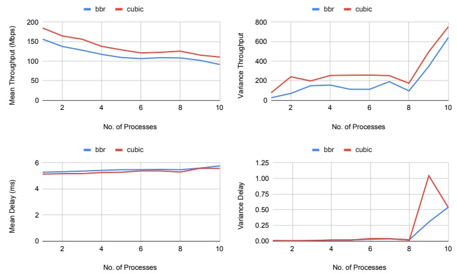

Fig. 9. The effect of number of parallel executions on experienced throughput and delay.

In Figure 9, we report the mean and variance of throughput and latency obtained by bbr and cubic when varying the parallelism level from 1 to 10 simultaneous evaluations. While the effect on mean latency is negligible, the mean throughput gradually decreases as parallelism increases. Beyond 8 parallel evaluations (i.e., at 9 and 10), the variance increases sharply. This behavior arises from hardware contention: the experimental server had 30 CPU cores, and each execution required three dedicated cores––one for the emulator, one for the iperf server, and one for the iperf client. With 9 or more parallel executions, the system begins to oversubscribe CPU resources, leading to higher variability in performance. Based on this observation, we constrained the parallelism level to at most 8 in our experiments.

For finding out the correct level of parallelism, we run AdvNet for 250 iterations (each iteration translates to picking a network environment and computing its score) using cubic as reference and bbr, highspeed, reno, and vegas as target. For each target protocol, we vary the number of parallel evaluations from 1 to an upper bound of 8.

Figure 10 shows the average result across the four target protocols. A single evaluation per environment yields a strong baseline score. As parallelism increases, score decreases and then increases again. This is due to two effects. First, we found that protocol throughput in the emulator degrades noticeably (Figure 9), even moving from 1 to 2 parallel tests, and even with the precaution of running on separate cores as noted earlier. This means AdvNet is effectively receiving somewhat inaccurate information about trace performance (note that we always perform final evaluation of the score of its output using a single emulation at a time). Second, as parallelism increases, the greater number of trials per trace gives AdvNet more samples to combat noise. The shape of these two competing

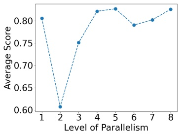

line

| Level of Parallelism | Average Score |
| --- | --- |
| 1 | ~0.805 |
| 2 | ~0.605 |
| 3 | ~0.752 |
| 4 | ~0.820 |
| 5 | ~0.825 |
| 6 | ~0.790 |
| 7 | ~0.802 |
| 8 | ~0.825 |

Fig. 10. Effect of parallelism on achieved score by GA.

effects is such that 5-way parallelism produces the best results for a given wall-clock time.

The difference in performance between using 1 and 5 evaluations per environment is relatively small, and the former would be preferable when aiming to minimize CPU usage. However, since the overall wall-clock time remains unchanged, we adopt 5 evaluations per environment for the remaining experiments to obtain the highest possible score. If a user chooses to use 1 evaluation per environment, however, it would not significantly affect the results.

Regarding the problem of parallelism degrading emulation performance, our optimizations of Mahimahi (e.g., generating PDOs on the fly rather than as a large input) reduced but did not eliminate the degradation. We suspect this is likely due to a bottleneck that could be improved, perhaps by running emulations in separate VMs. In addition, it would be possible to explore other uses of parallelism such as testing different traces in parallel rather than multiple runs of the same trace. We leave these optimizations to future work.

## B Post-Learning Selection Algorithms

Due to the prohibitively high runtime of evaluating selection strategies using real-world protocols, we performed a controlled simulation study.

In particular, in each trial of the simulation, we generate 50 Gaussian random variables. The true mean of each variable is selected randomly at the beginning of the simulation, uniformly between 0 and 100. Then, we apply one of the selection algorithms to identify the variable with the highest mean. Each selection algorithm was given the same sampling budget, representing the total number of samples it was allowed to draw from the random variables.

We test the following algorithms. **Oracle** returns the true optimal random variable, i.e., that with maximum mean; since there are 50 ran dom variables with means chosen uniformly at random from 0-100, this score averages just below 100. **RoundRobin** splits the budget equally among all variables (plus 1 extra for some, if the budget is not a multiple of 50). **OCBA** is the algorithm of [5], and **MRE** is our algorithm; these two are described in §3.3. **Two-Round Elimination (TRE)** is a simpler two-round evalua tion that begins by evaluating all environments a fixed number of times (2); then, the top 25% of

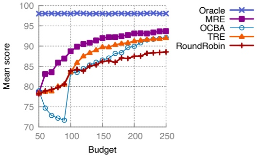

line

| Budget | Oracle | MRE | OCBA | TRE | RoundRobin |
| --- | --- | --- | --- | --- | --- |
| 50 | ~98 | ~78 | ~79 | ~78 | ~78 |
| 60 | ~98 | ~83 | ~75 | ~79 | ~79 |
| 70 | ~98 | ~84 | ~73 | ~79 | ~79 |
| 80 | ~98 | ~86 | ~72 | ~80 | ~80 |
| 90 | ~98 | ~87 | ~72 | ~81 | ~81 |
| 100 | ~98 | ~89 | ~84 | ~84 | ~84 |
| 110 | ~98 | ~90 | ~84 | ~86 | ~84 |
| 120 | ~98 | ~91 | ~85 | ~88 | ~85 |
| 130 | ~98 | ~91 | ~86 | ~89 | ~86 |
| 140 | ~98 | ~92 | ~86 | ~90 | ~86 |
| 150 | ~98 | ~92 | ~87 | ~90 | ~86 |
| 160 | ~98 | ~92 | ~87 | ~91 | ~87 |
| 170 | ~98 | ~93 | ~88 | ~91 | ~87 |
| 180 | ~98 | ~93 | ~89 | ~92 | ~87 |
| 190 | ~98 | ~93 | ~90 | ~92 | ~87 |
| 200 | ~98 | ~94 | ~90 | ~92 | ~88 |
| 210 | ~98 | ~94 | ~91 | ~92 | ~88 |
| 220 | ~98 | ~94 | ~91 | ~92 | ~88 |
| 230 | ~98 | ~94 | ~92 | ~92 | ~88 |
| 240 | ~98 | ~94 | ~92 | ~92 | ~88 |
| 250 | ~98 | ~94 | — | — | — |

Fig. 11. Mean score achieved by different selection algorithms for different budgets.

performers from the first round are repeatedly re-evaluated until the evaluation budget is exhausted.

Figure 11 shows the average results over 2000 independent trials, where each trial consists of generating a fresh set of 50 random variables and allowing the selection algorithm to identify the best one. The score of a run is the true mean of the variable selected by the algorithm. MRE outperforms all competing strategies, leading us to adopt MRE as the selection mechanism in AdvNet’s PLS phase.

For OCBA, we observe that when the sampling budget is below 100, the mean score remains very low and even decreases as the budget increases. This behavior arises because OCBA relies heavily on accurate variance estimates for each alternative. With 50 variables in the pool, a budget below 100 allows at most one sample per variable during the warm-up phase, yielding no meaningful variance estimates. Once the budget reaches 100, OCBA’s performance improves rapidly, and the mean score increases steadily with additional budget. As the budget approaches 250, OCBA becomes the second-best performing method among the evaluated selection strategies.

## C DChannel Parameter Bounds

<table><tr><td rowspan="2"></td><td colspan="2">eMBB</td><td colspan="2">URLLC</td><td colspan="3">eMBB &amp; URLLC</td></tr><tr><td>Bandwidth</td><td>Latency</td><td>Bandwidth</td><td>Latency</td><td>Duration</td><td>Queue Length</td><td>Data size</td></tr><tr><td>Lower Bound</td><td>15 Mbps</td><td>10 ms</td><td>2.5 Mbps</td><td>2 ms</td><td>50 ms</td><td>100</td><td>500 KB</td></tr><tr><td>Upper Bound</td><td>150 Mbps</td><td>125 ms</td><td>5 Mbps</td><td>5 ms</td><td>50 ms</td><td>5000</td><td>50000 KB</td></tr></table>

Table 3. Parameters used in all experiments with AdvNet for DChannel. The lower and upper bounds for each parameter are defined per timestep. We adopted these values from the original paper, with the exception of adjusting the bounds for URLLC latency and Data size to increase the likelihood of challenging DChannel.

## D ML-based input generation

Using ML to generate complex test input is not new. An automatic test-data generation tool utilizing GA was proposed in [21]. For instance, recent work integrating ML and test input generation has been done with fuzz testing for PDF parsers [11]. Using ML to generate tests for software dates back more than a decade [26]. Our approach bears similarities to generative adversarial networks (GANs) [12]. GANs, however, represent a supervised learning approach and, more importantly, our goal is substantially different. GANs are typically useful for generating new data that is indistinguishable from an existing dataset (see [3] for a recent example of applying GANs to networking domains). In our context, we do not already possess traces of challenging network conditions to which GANs might be applied, but aim to create such challenging traces.

Received December 2025; accepted April 2026